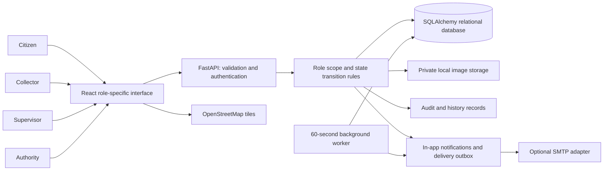

# Architecture

The application is a modular monolith: a React client talks to a FastAPI application, which enforces access and workflow rules before persisting through SQLAlchemy. SQLite makes the college demo self-contained; PostgreSQL is configured for deployment.

`security.py` handles authentication and role checks. `services.py` centralizes row scopes, version checks, notifications, deadlines, distance and escalation. `schemas.py` restricts writable input. `storage.py` separates file persistence from validation. `providers.py` isolates optional email delivery. `main.py` contains route-level orchestration. The browser does not determine authorization.

Complaint transitions, history, audit and notifications are written in one transaction. Files are saved under generated keys and removed if the associated database commit fails. Existing evidence is retained across cycles. Database versions reject concurrent stale changes with HTTP 409.

Email happens after complaint transactions commit. The embedded worker processes up to 25 due deliveries per cycle, retrying failures at five-minute multiples, at most three attempts. SMTP acceptance is recorded as SENT; it is not proof of recipient delivery. Missing configuration is recorded as NOT_CONFIGURED and never reported as sent.

The scheduler requires one application process. Multiple web workers require a separate job process with database claiming/locking before deployment. The current embedded design is deliberate and explainable for a final-year project.

The UI uses system fonts and local bundled code. OpenStreetMap tile access is optional for the core coordinate workflow; coordinates and manual addresses remain usable offline. No GPS position is collected until the user requests it and accepts browser permission.
