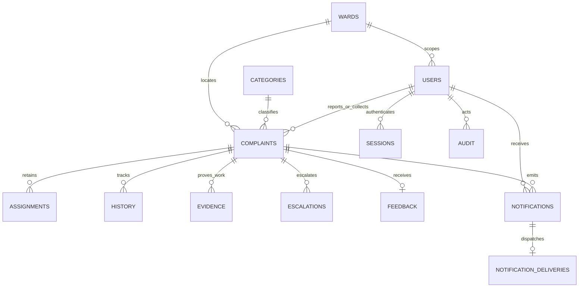

# Database design

All timestamps represent UTC; SQLAlchemy stores normalized UTC values without a timezone suffix in the database and the API emits `Z` timestamps. The UI uses browser locale for display.

| Table | Main fields and rules |
|---|---|
| wards | unique name, zone name; pragmatic ward-to-zone grouping |
| categories | unique configurable name |
| sla_rules | priority primary key, positive resolution hours |
| users | id, unique email, Argon2 hash, role, optional ward FK, active/available, created timestamp |
| sessions | SHA-256 token hash primary key, user FK, expiry; raw token is never persisted |
| complaints | unique reference, citizen/collector/ward/category FKs, coordinates, classification, status, deadline, completion timestamps, cycle/reopen count/version |
| assignments | complaint/collector/supervisor FKs, reason, timestamp; append-only through API |
| history | complaint/actor FKs, previous/new state, reason and timestamp |
| evidence | complaint/uploader FKs, stage/cycle, private key, normalized-image SHA-256, size and timestamp |
| notifications | recipient/complaint FKs, message, read flag and timestamp |
| notification_deliveries | unique notification FK, external delivery status, attempts, next-attempt time, sanitized error type |
| audit | optional actor FK, action, entity reference, detail and timestamp |
| escalations | complaint FK, cycle, level, timestamp; unique complaint/cycle/level prevents repeats |
| feedback | unique complaint FK, rating 1–5, comment |

Indexes cover complaint owner, collector, ward, category, status, creation date; history/evidence/assignment/escalation complaint IDs; notification recipient/read state; session user; user role; delivery status; evidence hash. Latitude/longitude and feedback ratings have database check constraints. There is no cascading deletion of operational records; no delete API is exposed. Deactivation preserves history.

Migration 001 is a frozen explicit schema, independent of future model changes. Migration 002 adds the external-delivery outbox. Tests migrate an empty database to 001, insert a ward, upgrade to 002, verify the ward survives, and repeat upgrade safely. Destructive downgrade is intentionally unavailable; restore a verified backup instead. Production data migrations must always be reviewed and tested on a copy.

Complaint versions are SQLAlchemy version counters. Clients submit the version for transitions and assignment; ORM conditional updates also protect simultaneous writes. Uploads increment the complaint version so a concurrent reassignment cannot attach evidence to an outdated work cycle.
