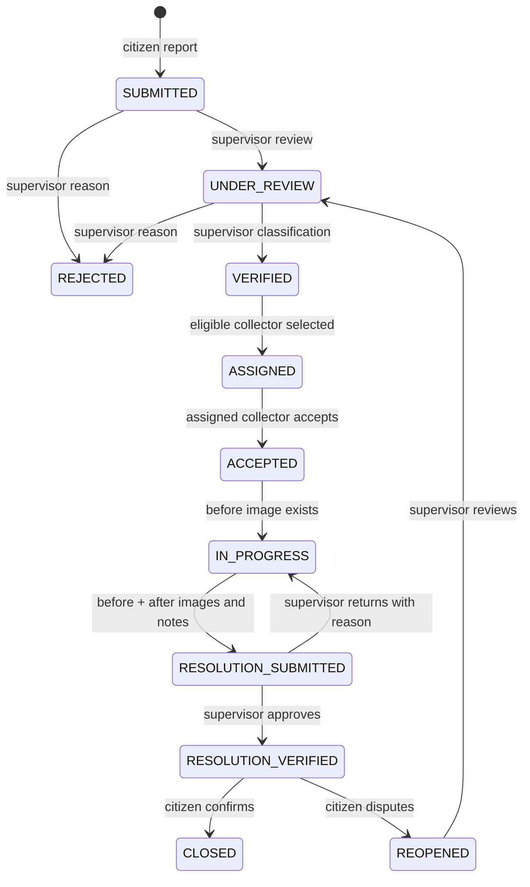

# Workflow and algorithms

There is no generic “set status” API. Role, row scope, current state and submitted version must all pass. A collector cannot approve their own completion. An authority monitors/configures; it does not silently replace the supervisor workflow.

Reassignment is allowed from VERIFIED, ASSIGNED, ACCEPTED and IN_PROGRESS. It requires an eligible different collector and a reason. History retains previous assignments. Reassignment, returned work and citizen reopen increment the evidence cycle. The collector must supply fresh images for the current cycle; previous images remain readable.

Citizen reopen is allowed only from RESOLUTION_VERIFIED, within seven days and up to twice. CLOSED is final in this implementation. Citizen feedback is accepted once after closure. Automatic citizen confirmation is intentionally not assumed.

## Assignment recommendation

Filter to active and available collectors in the same ward. Active workload counts complaints whose current status is not CLOSED, REJECTED or RESOLUTION_VERIFIED. Score = **100 / (1 + active workload)**; higher scores rank first, ties use collector ID. Supervisors choose the final assignment. Distance is not used because collector live positions are not collected; it is not an AI algorithm.

## Duplicate warning

Compare unresolved complaints of the same category submitted within seven days. Calculate great-circle distance using Haversine, earth radius 6,371,000 metres; count candidates within 100 metres. The citizen sees only a count, never other citizens' private details. A warning does not reject the new report. Images are additionally checked for identical normalized-content SHA-256 within the same complaint; this prevents trivial reuse, not image forgery.

## SLA and escalation

Default hours: LOW 120, NORMAL 72, HIGH 24, URGENT 8. Initial deadline starts at submission and is recalculated from that submission timestamp when the supervisor validates priority. This avoids rewarding a delayed review. Reopened work receives a fresh target. Authority changes apply to future deadline calculations, not silently to every existing record. SLA uses elapsed clock hours, with no holiday/business-hours calendar.

An embedded worker runs every 60 seconds: warning level 0 within `SLA_WARNING_HOURS` (default 2); level 1 when breached to ward supervisors; level 2 after `ESCALATE_AFTER_HOURS` (default 24) to authority users. Each complaint/cycle/level is unique. Escalation records and notices are transactional. If a worker starts after a long outage it records the currently applicable level, not fabricated intermediate events.

SLA compliance = verified resolutions at or before their current deadline / all currently resolved complaints. Average/median hours measure original submission to current supervisor verification, so reopen time is included. Reopened reports whose new work is still pending are excluded from resolved denominators. Escalated count is historical for the filtered complaints. Charts explicitly show “—” where no denominator exists.

Hotspots group coordinates rounded to 0.001 degrees and show both historical count and currently unresolved count. This is a grid approximation, not a predictive model or exact fixed-radius cluster. Collector metrics reflect current ownership, not attribution of every past work cycle.
